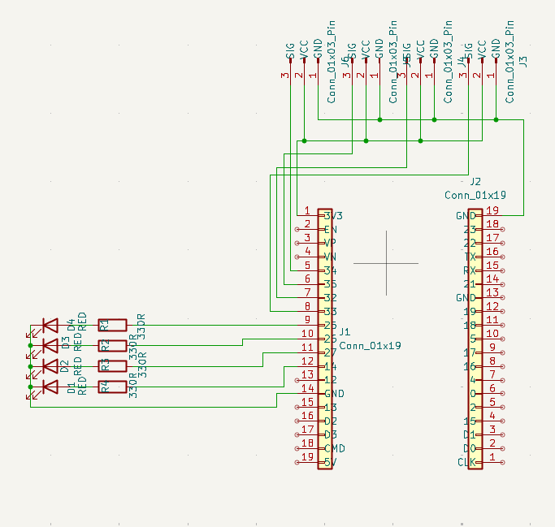
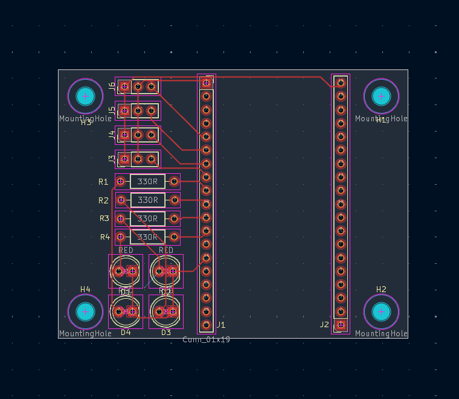
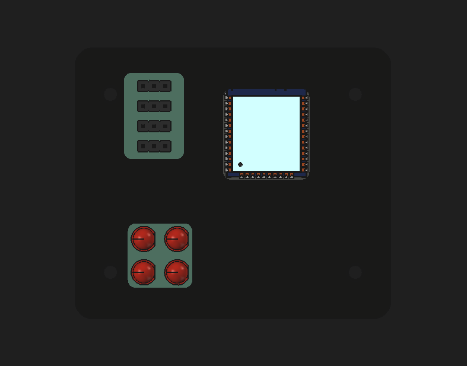
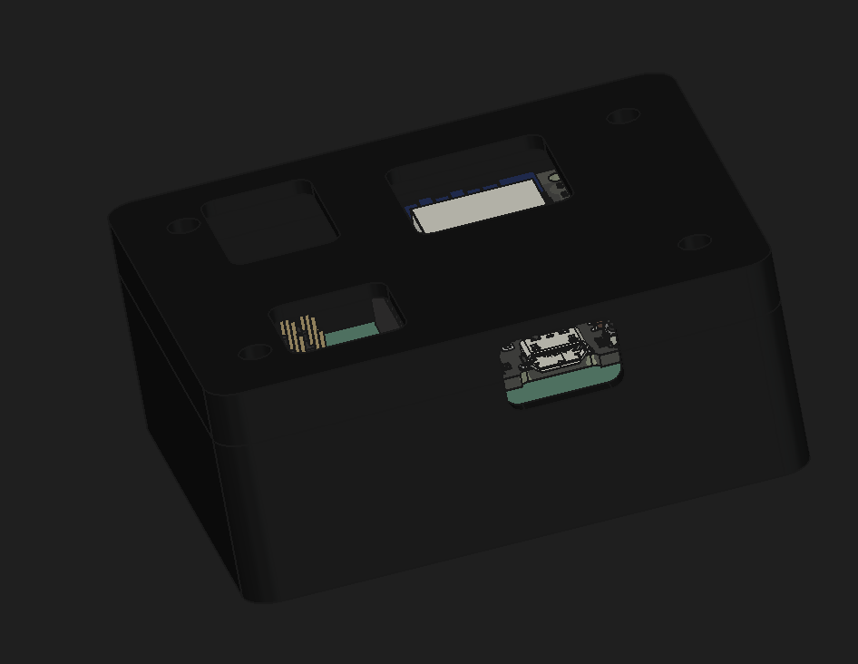
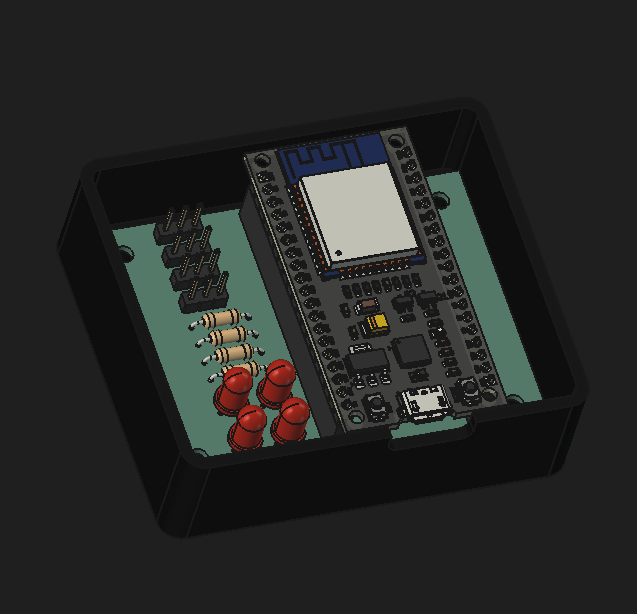

# Plant Soil Moisture Sensor

A compact soil moisture sensing system including custom PCB designs, 3D printable casing, and firmware source code.

## Hardware & Schematics

### PCB Layout & Schematic
| Schematic | PCB Design |
| :---: | :---: |
|  |  |

---

## Gallery

| Top View | Top-Side View 1 | Top-Side View 2 |
| :---: | :---: | :---: |
|  |  |  |

---

## Project Structure

```text
PlantSoilMoistureSensor/
├── case/     # 3D printable case / CAD files
├── media/    # Images and project media
├── pcb/      # KiCad PCB schematics and layout
└── src/      # Firmware source code